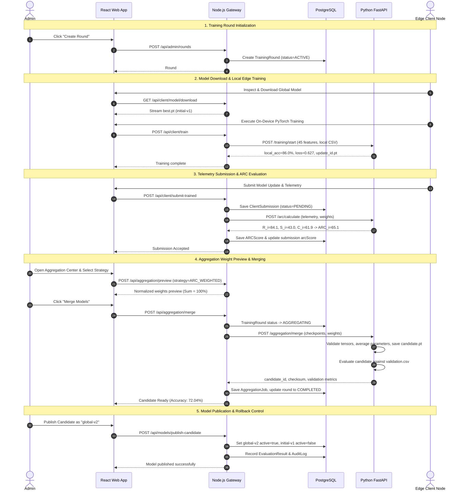

# ARC-FL System Architecture Reference
## Formal Engineering Specification

This document details the architectural topology, service isolation, network boundaries, data flow pipelines, and security mechanisms of the **ARC-Based Federated Learning Platform**.

---

## 1. System Topology & Monorepo Structure

The platform is designed around a strictly decoupled four-tier architecture:

```
+---------------------------------------------------------------------------------+
|                                 WEB BROWSER                                     |
|                                                                                 |
|   +----------------------------------+     +--------------------------------+   |
|   |         CLIENT DASHBOARD         |     |        ADMIN DASHBOARD         |   |
|   | (Model DL, Training, Submissions)|     | (Fleet, ARC Config, Aggregation|   |
|   +----------------------------------+     +--------------------------------+   |
+----------------------------------------+----------------------------------------+
                                         | HTTP / REST (JWT Auth)
                                         v
+---------------------------------------------------------------------------------+
|                   PRIMARY APPLICATION BACKEND (Node.js & Express)               |
|                               Port: 5000                                        |
|                                                                                 |
|  - REST API Gateway & Route Guard Middleware (ADMIN vs CLIENT)                  |
|  - Stateless Session Security (JWT, bcrypt password hashing)                   |
|  - Telemetry Collection & Metadata Coordination                                 |
|  - Model Artifact File Streaming & Storage Management                           |
|  - Auditing & Historical Logs                                                   |
+-------------------+-------------------------------------+-----------------------+
                    | Prisma ORM (Port: 5433)             | HTTP + X-API-Key (:8000)
                    v                                     v
+--------------------------------------+  +---------------------------------------+
|          DATABASE (PostgreSQL)       |  |     MACHINE LEARNING SERVICE (Python) |
|   Database: arc_fl_db, Port: 5433    |  |     FastAPI + PyTorch, Port: 8000     |
|                                      |  |                                       |
| - Users & ClientProfiles             |  | - Neural Net Architecture (ResMLP v3) |
| - TrainingRounds & Submissions       |  | - On-Device PyTorch Edge Trainer      |
| - ARCConfigs & ARCScores             |  | - ARC Scoring Engine (v1.0)           |
| - AggregationJobs & Weights          |  | - Parameter Aggregator (FedAvg, ARC)  |
| - GlobalModels & Evaluations         |  | - Server-Side Validator (validation)  |
| - AuditLogs                          |  | - Checkpoint Hashing & State Loader   |
+--------------------------------------+  +-------------------+-------------------+
                                                              | File I/O
                                                              v
+---------------------------------------------------------------------------------+
|                       DEDICATED MODEL ARTIFACT STORAGE                          |
|                                                                                 |
|  storage/                                                                       |
|  ├── global-models/ (initial-v1/, global-v2/...) -> immutable published models  |
|  ├── client-updates/ (*.pt)                     -> edge client model weights    |
|  ├── candidates/ (*.pt)                         -> merged candidate models      |
|  └── datasets/ (*.csv)                          -> private client partitions    |
+---------------------------------------------------------------------------------+
```

---

## 2. Component Boundaries & Responsibilities

### 2.1 Frontend (React + Vite + Tailwind CSS)
- **Role:** Interactive UI for both edge participants (`CLIENT`) and system operators (`ADMIN`).
- **Communication:** Communicates **exclusively** with the Node.js backend on port 5000 via Axios interceptors. The frontend never accesses the Python ML service or PostgreSQL database directly.
- **Layout Specification:** Adheres to a strict **vertical card layout** for all client listings, fleet submissions, and evaluation records (avoiding horizontal table overload).
- **Visualization:** Integrates Recharts for loss descent, convergence trajectories, and ARC component score distribution.

### 2.2 Main Application Backend (Node.js & Express.js)
- **Role:** Central business logic engine, authentication provider, role-based authorization gate, and API gateway.
- **Security:**
  - Password encryption using salted `bcryptjs` hashing.
  - Role-based route guard middleware (`ADMIN` vs `CLIENT`).
  - Strict upload validation and request rate limiting.
- **Persistence:** Relational modeling and queries handled via Prisma ORM connected to PostgreSQL 18 on port 5433.
- **Storage Governance:** Manages physical file streaming, directory structures, and SHA256 checksum verification. Large model binaries are strictly isolated in filesystem storage and never stored as raw blobs inside PostgreSQL.

### 2.3 Machine Learning Service (Python FastAPI & PyTorch)
- **Role:** Pure ML computation worker. Handles mathematical calculations, neural network evaluation, and tensor manipulations:
  - Loading and instantiating `preact_resmlp_v3` deep learning models (45 inputs, 34 attack categories, 4,981,628 parameters).
  - Executing client local training epochs with SGD and CrossEntropyLoss.
  - Evaluating ARC multi-criteria importance scores ($R_i, S_i, C_i$).
  - Validating update state dictionaries for key/shape conformity and NaN/Inf corruption.
  - Executing parameter aggregation across layers and BatchNorm tracking counters.
  - Evaluating candidate models against `validation.csv`.
- **Authentication:** Service-to-service communication secured via loopback HTTP with a pre-shared `X-API-Key` secret header.

### 2.4 Database (PostgreSQL 18)
- **Relational Integrity:** Fully normalized relational schema with cascading deletions and foreign keys:
  - `users`: Core account credentials and role assignments.
  - `client_profiles`: Edge node device specs, telemetry status, and connection states.
  - `training_rounds`: Federated round states (`CREATED`, `ACTIVE`, `AGGREGATING`, `COMPLETED`, `FAILED`).
  - `client_submissions`: Checkpoint metadata, training accuracy, loss, sample counts, and storage pointers.
  - `arc_configs`: Dynamic parameter configurations for $\lambda_R, \lambda_S, \lambda_C$.
  - `arc_scores`: Historical snapshots of calculated component and composite scores.
  - `aggregation_jobs`: Aggregation runs, chosen strategies, and validation reports.
  - `aggregation_weights`: Exact normalized weight $\alpha_i$ assigned to each client.
  - `global_models`: Immutable version registry with baseline metrics and rollback pointers.
  - `audit_logs`: Immutable security and administrative activity log.

---

## 3. End-to-End Federated Learning Workflow



---

## 4. Privacy & Security Guarantees

1. **Zero Raw Data Transmission:**
   Edge network traffic datasets (`client1_traffic.csv`, `client2_traffic.csv`, `client3_traffic.csv`) reside exclusively in the client device's partition. Only mathematical weight updates (`.pt`) and high-level statistical summaries are transmitted to the server.
2. **Model Poisoning Protection:**
   The aggregation engine inspects every parameter tensor in incoming client updates:
   - Verifies exact matching of layer names and shape dimensions.
   - Strictly rejects updates containing `NaN` or `Inf` values.
3. **Immutability of Historical Checkpoints:**
   Published model versions (`storage/global-models/`) are read-only. Updates create new version increments rather than overwriting existing directories, ensuring historical rollbacks are deterministic.
4. **Audit Trail Accountability:**
   All configuration edits, model publications, and rollbacks are recorded in the `audit_logs` table with user attribution, IP addresses, and previous/new parameter snapshots.
